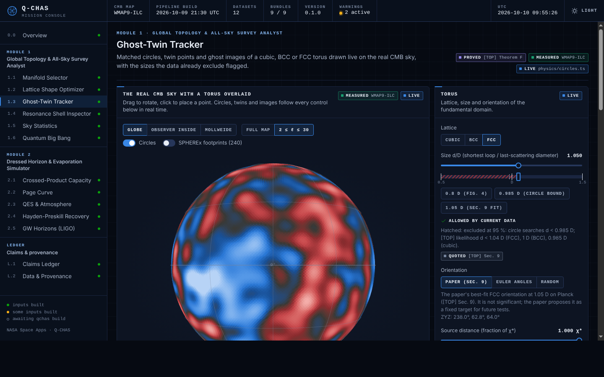

# Q-CHAS · Quantum Cosmology & Horizon Analytics Suite

**NASA International Space Apps Challenge submission.** Q-CHAS is an analytics pipeline and
mission-control dashboard that confronts three new results in mathematical physics with
real public survey data: **Planck PR3** and **WMAP 9-year** CMB maps, **SPHEREx** Level-2
spectral images, and **LIGO-Virgo** strain.

| Module | What it does | Real data it uses |
|---|---|---|
| **1 · Global Topology & All-Sky Survey Analyst** | Selects the shape of flat space from four principles, relaxes the torus shape under Standard-Model Casimir stress, draws the predicted circles-in-the-sky and ghost images, quantifies how much any survey can ever learn about topology, and runs the topological-resonance (rank-N Woodbury) test | Planck PR3 Commander / WMAP 9-yr ILC maps and spectra; SPHEREx QR3 footprints |
| **2 · Dressed Horizon & Evaporation Simulator** | Turns the type III₁ → II algebra ladder into a horizon capacity A/4G, plots Hawking's curve against the Page transfer law, locates the quantum extremal surface and the quantum atmosphere, simulates exactly unitary evaporation and Hayden-Preskill recovery, and evolves the unitary quantum Big Bang | LIGO strain of GW150914, LVT151012, GW151226, GW170104; GWOSC catalogue |



The repository ships with a complete build from real data in `web/public/data/`, so the
dashboard runs immediately: `cd web && npm install && npm run dev`. Views: Overview;
Module 1 — Manifold Selector, Lattice Shape Optimizer, Ghost-Twin Tracker, Resonance Shell
Inspector, Sky Statistics, Quantum Big Bang; Module 2 — Crossed-Product Capacity, Page Curve,
QES & Atmosphere, Hayden-Preskill Recovery, GW Horizons (LIGO); Claims Ledger (with the
reproduction ledger) and Data & Provenance.

## The science, stated as the papers state it

Q-CHAS implements three research notes (PDFs supplied with the submission):

* **[TOP]** *Selecting the shape of flat space* — the 3-torus is the only one of the 18 flat
  3-manifolds compatible with principles P1–P3 (or P2 + P4); FCC and BCC tori are strict local
  minima of the Standard-Model Casimir energy and the simple cubic torus is a saddle
  (interval-arithmetic certified); circles-in-the-sky geometry; a causal *law of limitation* on
  what any observation can learn about topology.
* **[QG]** *Quantum gravity from the crossed product* — imposing a gravitational constraint on a
  type III₁ field algebra is a crossed product; time, the state of the universe, a unitary
  Big Bang (bounce at ⟨a⟩ ≈ 0.26 ℓ_P) and black-hole information follow.
* **[BH]** *What field theory forbids, and what the horizon must do* — field theory on a fixed
  background forces Hawking's curve; finite capacity A/4G (derived from the crossed product)
  forces the island and the Page transfer law S(R) ≤ min{S_H, A/4G}.

**What the data say, honestly.** The Planck 2018 sky shows **no evidence** for a torus of any
allowed size (all tests p ≥ 0.11) and **no topological resonance** (pre-registered search,
p = 0.78); it *excludes* small tori (d > 1.04 D for FCC at 95 %). Topological resonance — a
narrow primordial line on a dual-lattice shell — amplifies the topological information by up
to **64× at known orientation**; with the orientation unknown the SO(3) search consumes most of
that gain. A torus as large as **3 D** could be decided only by a **multi-field primordial line
mapped in three dimensions** (for example dark-ages 21-cm tomography), not by the CMB alone.
Q-CHAS reproduces these statements and shows the numbers behind them; it does not claim a
detection. The *Claims Ledger* view lists every statement with its status (theorem,
computation, data analysis, hypothesis) exactly as the papers' own status tables do.

## Quick start

```bash
python -m venv .venv && . .venv/bin/activate
pip install -e ".[dev]"
qchas fetch            # WMAP, Planck spectra, LIGO strain, GWOSC catalogue (add --planck for the 1.6 GB map)
qchas build            # run every analysis, write web/public/data/*
cd web && npm install && npm run dev
```

`qchas fetch` tries every mirror of every dataset (see `qchas/data/registry.py`) and records
URL, size and SHA-256 of each file in `data/raw/provenance.json`; the dashboard's *Data &
Provenance* view shows that record. If an archive is unreachable the build falls back to the
data that is present (for example WMAP instead of Planck) and says so in the status bar — it
never substitutes simulated data for observations.

The GitHub Actions workflow `.github/workflows/pages.yml` performs the full build, including
the Planck PR3 map, on a GitHub-hosted runner and publishes the dashboard to GitHub Pages. It
runs on pushes to `main` (or manually); enable Pages once with *Settings → Pages → Source:
GitHub Actions*.

## Repository layout

```
qchas/            Python analytics core (see docs/ARCHITECTURE.md for every module)
  data/           registry, downloader, SPHEREx S3 reader, LIGO strain tools
  topology/       18 manifolds, lattices & Casimir energy, shape flow, circles, vacuum
  cmb/            harmonics, CAMB transfer functions, torus covariance, Woodbury resonance,
                  map pipeline, statistics, orientation-scanned likelihood
  horizon/        Page law, capacity, QES, atmosphere, unitary evaporation, bounce, Kerr
web/              Vite + TypeScript dashboard (Three.js globe, Plotly charts)
tests/            pytest suite, including validations against every printed paper table we reproduce
docs/             architecture and data contract
```

## Validation against the papers

`qchas build` writes `validation.json`, which compares every number Q-CHAS recomputes from scratch with the value printed in the papers: **169 of 173 match** (within tolerance or to the printed precision). The dashboard's Claims Ledger shows every row.

| Result reproduced | Rows | Match |
|---|---|---|
| QES ([BH] Sec. 9) | 36 | 36 |
| Quantum atmosphere ([BH] Sec. 10) | 7 | 7 |
| Page transfer law ([BH] Fig. 1) | 2 | 2 |
| Crossed product ([QG] Theorem U) | 1 | 1 |
| Unitary evaporation ([BH] Sec. 11) | 5 | 5 |
| Hayden-Preskill decoding ([QG] Theorem R) | 9 | 9 |
| Casimir lattice ([TOP] Prop. E.2) | 9 | 9 |
| Shape flow ([TOP] Sec. 6.3) | 1 | 1 |
| Circles in the sky ([TOP] Sec. 7) | 9 | 9 |
| Detectability KL ([TOP] Theorem P) | 21 | 21 |
| Large-angle CMB ([TOP] Sec. 8) | 15 | 15 |
| Low-l anomalies ([TOP] Sec. 8) | 3 | 3 |
| Topological resonance ([TOP] Sec. 11.6) | 20 | 20 |
| Quantum Big Bang ([QG] Theorem Lambda) | 16 | 12 |
| Kerr ringdown and echoes ([QG] Sec. 19) | 19 | 19 |

Highlights:

* The QES solver reproduces all 12 rows of [BH] Sec. 9 to every printed digit; the Srednicki lattice reproduces the quantum-atmosphere profile (area-law coefficient 0.2952).
* The certified Casimir values Z(2) for SC, BCC and FCC agree to 6e-16; 240 gradient flows end at FCC in 79.8 % of cases (paper: 79 ± 3 %).
* The torus covariance reproduces the Theorem P KL table, the Sec. 8 table and the Sec. 11.6 resonance gains (64× at known orientation) to about 1 %.
* The exactly unitary 20-qubit evaporation reproduces [BH] Sec. 11 (10.28 bits at step 11; diaries recovered at steps 13 and 17) and the [QG] Theorem R decoding table.

Where we differ from the printed papers, we say so:

* **[TOP] Prop. E.2, BCC Hessian.** The printed 3.3953 violates the exact identity tr H = 2Z/3; analytic and finite-difference Hessians give 3.39504.
* **[QG] Theorem Λ table.** The printed bounce numbers are reproduced on the paper's own finite-difference grid; the exact solution gives a larger peak ⟨a⁻²⟩ (270.7 vs 262 at a_max = 2) and ⟨a⟩_min → 0.1629 ℓ = 0.260 ℓ_P. These 4 rows are the 'differs' entries.
* **[TOP] Sec. 4.** "Every manifold except E1 fails at least two principles" does not hold for E11, E16 and E18, which fail only P2 by the paper's own table.

**Our own analysis of the real sky** (WMAP 9-year ILC, because the Planck archive is unreachable from the build sandbox; the GitHub Pages build uses Planck PR3):

* Pre-registered topological-resonance search (160 models, 100 null skies): S_max = 0.86, p = 0.79; S_avg = 0.02, p = 0.58. Paper on Planck: S_max = 1.01 (p = 0.78), S_avg = −0.03 (p = 0.53). **No resonance in either map.**
* Orientation-scanned torus likelihood, 21 models (FCC, BCC, cubic; 0.985–1.3 D), 100 null skies each: the smallest single-model p is 0.03 (cubic, 1.3 D), the same value the paper's Table 9a reports for that model on Planck; with 21 models searched this is the expected look-elsewhere scatter (the paper's global test gives p = 0.15). **No evidence for a torus**, as the paper finds on Planck.
* Low-ℓ anomalies and the quadrupole–octopole alignment are computed for the published WMAP spectrum and for our own map extraction; see the Sky Statistics view.

## Data sources

| Mission | Product | Archive |
|---|---|---|
| Planck (ESA) | PR3 Commander CMB map, TT power spectrum | NASA/IPAC IRSA, ESA PLA |
| WMAP (NASA) | 9-year ILC map, TT spectrum, KQ75 mask | NASA LAMBDA (S3) |
| SPHEREx (NASA) | Quick-Release Level-2 spectral images | NASA/IPAC IRSA (S3 `nasa-irsa-spherex`) |
| LIGO-Virgo-KAGRA | GW150914, LVT151012, GW151226, GW170104 strain; event catalogue | GWOSC |

Based on observations obtained with Planck (http://www.esa.int/Planck), an ESA science mission
with instruments and contributions directly funded by ESA Member States, NASA, and Canada.
This research has made use of data obtained from the Gravitational Wave Open Science Center
(gwosc.org), a service of LIGO, Virgo and KAGRA; of NASA's Legacy Archive for Microwave
Background Data Analysis (LAMBDA); and of the NASA/IPAC Infrared Science Archive (SPHEREx).
